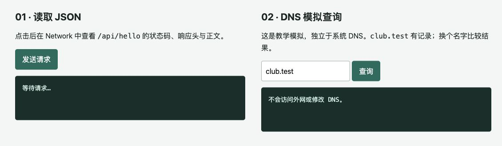

:::section{.lang-zh}

> 此文由 Codex 根据 Bob Gong 的课件改编。

上一课，我们在网页源代码和脚本里找到了页面没有显示的内容。接下来还有一个问题：**浏览器究竟去哪里拿到了这些东西？**

在地址栏敲下一串网址，网页似乎就自己出现了。可一旦打不开，我们又很容易只剩一句“网坏了”。其实，域名找不到、端口没开和服务器返回 404，是不同阶段发生的问题。弄清它们，排查时就不用靠反复刷新碰运气了。

这次我们用自己电脑上的实验站，把一次访问拆开来看。

## 先读懂地址栏里的这一行

```text
http://127.0.0.1:8765/api/hello?name=Turing
```

这行地址包含了几项不同的信息：

| 部分 | 本例中的内容 | 作用 |
| --- | --- | --- |
| 协议 | `http` | 约定如何交换消息 |
| 主机 | `127.0.0.1` | 指定要连接的地址 |
| 端口 | `8765` | 指定目标服务的端口 |
| 路径 | `/api/hello` | 指定请求哪个资源 |
| 查询参数 | `name=Turing` | 给这个资源传递参数 |

把 `name=Turing` 改成 `name=Alice`，仍然是在访问同一个地址、同一个端口，只是传入的参数变了。把 `8765` 改成 `8766`，则是在连接另一个端口。

你可能还见过网址末尾的 `#section`。这样的片段通常供浏览器定位页面内容使用，不会作为 HTTP 请求目标的一部分发送给服务器。

## IP 找地址，端口找服务

IP 地址用于网络寻址。一台电脑可能同时有 Wi-Fi、网线和回环等多个网络接口，拥有不同的地址；某些地址还会随着网络连接变化。因此，不要把 IP 理解成某台设备永远不变的身份证。

本课只需要先认识两个例子：

- `127.0.0.1` 是 IPv4 回环地址，连接的是你自己的电脑。
- `192.168.1.20` 是一个私有地址示例，这类地址常见于局域网中。

当你和同桌分别访问 `127.0.0.1` 时，你们访问的是各自的电脑。地址写得一模一样，目标却不在同一台设备上。

端口让同一个 IP 上的不同服务能够接收各自的通信。可以暂时把 IP 类比为楼的地址，把端口类比为办事窗口：找到楼以后，还得知道要去哪一个窗口。

```text
127.0.0.1:8765  本地实验服务 A
127.0.0.1:8766  本地实验服务 B
```

HTTP 的常见默认端口是 `80`，HTTPS 是 `443`，也可以显式使用其他端口。端口号只是定位信息，不能仅凭“用了 443”就断言那里一定运行了正确、安全的 HTTPS 服务。

`localhost` 通常也指向本机回环地址，但不同系统可能优先使用 IPv6。为了减少环境差异，下面统一使用 `127.0.0.1`。

## DNS 解决“记不住 IP”的问题

访问真实网站时，我们通常输入域名。DNS 可以帮助查询域名的相关记录，其中 `A` 记录对应 IPv4 地址，`AAAA` 记录对应 IPv6 地址。一个域名可能有多个地址，也可能没有你要查询的记录。

可以把常见访问过程先理解为：查询域名对应的地址，再连接目标服务，最后发送 HTTP 请求。实际浏览器还可能利用缓存、代理等机制，不一定每次都重新查询 DNS。

DNS 负责提供记录，网页内容则要通过后续请求获取。这就解释了为什么“域名解析成功”和“网页能打开”是两回事：你可以查到地址，但目标服务依然可能没有启动。

## 启动本地请求观察站

准备 Python 3 和浏览器，下载并完整解压[第二课学生实验工具包](../../downloads/network-security-02-student-lab.zip)。在解压后的 `student-lab` 文件夹中打开终端。

macOS 或 Linux：

```bash
python3 server.py
```

Windows：

```powershell
py -3 server.py
```

也可以使用包里的启动器：Windows 双击 `start-lab.bat`，macOS 双击 `start-lab.command`。如果 macOS 不允许运行脚本，按上面的终端命令启动即可。

看到启动提示后访问：

```text
http://127.0.0.1:8765
```

这次需要运行包里的 **`server.py`**，它提供了后面的 API、跳转和错误响应。上一课的 `python3 -m http.server` 只能提供静态文件，不能替代这里的实验服务。

整个实验离线可用，服务只监听本机回环地址。终端窗口保持打开，实验结束按 `Ctrl+C` 停止；无需修改防火墙、hosts 或系统 DNS。

## 在 Network 中看见一次请求

在浏览器中打开开发者工具，选择 **Network / 网络**。Chromium 浏览器在 Windows 上通常可用 `F12` 或 `Ctrl+Shift+I`，macOS 上通常用 `Command+Option+I`，也可以右键选择“检查”。

先清空旧记录，再点击实验站里的“发送请求”。页面会访问 `/api/hello?name=Turing`，在列表中找到这条请求。



在 **Headers / 标头** 中查看请求 URL、请求方法和状态码，在 **Response / 响应** 中查看正文。你会看到类似这样的 JSON：

```json
{
  "message": "Hello, Turing",
  "port": 8765
}
```

再直接访问 `http://127.0.0.1:8765/api/hello?name=Alice`，看看 `message` 如何变化。浏览器将参数发给服务器，服务器据此生成回答，整个过程都能在 Network 中留下证据。

### 请求和响应分别长什么样

一个用于理解 HTTP/1.1 的简化请求如下：

```http
GET /api/hello?name=Turing HTTP/1.1
Host: 127.0.0.1:8765
Accept: application/json
```

`GET` 是请求方法，接下来是路径和查询参数。`Host` 标识目标主机与端口，`Accept` 表示客户端希望接受的内容类型。

本地 Python 实验服务器返回 HTTP/1.0 响应。下面只列出部分响应头：

```http
HTTP/1.0 200 OK
Content-Type: application/json; charset=utf-8
X-Lab-Port: 8765

{"message":"Hello, Turing","port":8765}
```

状态行告诉我们请求结果，响应头说明正文类型等信息，空行之后是正文。HTTP/2、HTTP/3 的线格式与这里的文本示例不同，浏览器会把它们整理成便于阅读的字段。

### 响应头里也有线索

在 **Response Headers / 响应标头** 里找一找 `X-Lab-Flag`。找到后再问自己：它为什么没有出现在页面正文里，却依然能被查看？

因为它同样属于服务器发给浏览器的数据。把秘密放进响应头，和放进 HTML 注释一样，都不能实现保密。

再打开 `http://127.0.0.1:8766/api/hello`，比较两个端口的 `X-Lab-Port` 与正文中的 `port`。它们是本实验添加的观察线索，可以证明请求由哪个端口上的服务接收。

## 302、403、404，别都归咎于“断网”

回到实验站，在 Network 中勾选 **Preserve log / 保留日志**，再依次打开状态码实验链接。

| 路径 | 状态码 | 本实验中的含义 |
| --- | --- | --- |
| `/api/hello` | `200` | 成功返回内容 |
| `/moved` | `302` | 要求浏览器访问 `Location` 中的新地址 |
| `/destination` | `200` | 跳转后成功返回内容 |
| `/forbidden` | `403` | 服务器拒绝提供该资源 |
| `/missing` | `404` | 没有找到对应路径的资源 |
| `/unavailable` | `503` | 模拟服务暂时不可用 |

打开 `/moved` 时，最终页面成功显示，但 Network 中应该保留两次请求：先收到 `302`，再访问 `/destination` 收到 `200`。如果只看最后一条，很容易错过跳转过程。

`403`、`404` 和 `503` 都说明你已经收到了 HTTP 响应。这里的错误由实验服务主动生成，不是电脑突然出故障。`/unavailable` 还带有 `Retry-After: 60`，表示服务器建议等待 60 秒后再尝试。

## 亲手比较 404 和连接失败

先访问 `/missing`，确认它返回 `404`。接着回到启动窗口，按 `Ctrl+C` 停止服务，再刷新首页。

这次浏览器通常会显示连接失败或连接被拒绝。服务器已经停止，所以这次访问不会收到它返回的 HTTP 状态码。即便窗口里还留着旧页面，也要以刷新后的请求记录为准。

排查时可以按这样的顺序判断：

| 看到的证据 | 可以先检查什么 |
| --- | --- |
| 域名查询没有结果 | 域名拼写、解析器与网络环境 |
| 连接被拒绝 | 目标地址、端口、服务是否启动，以及拒绝连接的网络规则 |
| 连接超时 | 网络路径、过滤规则或目标服务状态，原因需要继续确认 |
| 收到 HTTP `404` | 实际请求的路径，以及服务器如何处理该路径 |

错误信息提供线索，但往往不能单独证明唯一原因。有了请求记录，再做下一步判断，效率会比盲目刷新高很多。

## DNS 模拟能说明什么

重新启动实验站，在 DNS 模拟区域分别查询 `club.test` 和 `unknown.test`。前者返回模拟的 `A` 记录 `127.0.0.1`，后者返回模拟的 `NXDOMAIN`，表示该模拟域名不存在。

**这是通过本地 HTTP 接口展示的教学模拟。** 它不会修改系统 DNS，也不会让你直接在地址栏输入 `club.test` 就能访问实验站。查询结果里有明确的 `SIMULATION ONLY` 标记，用来区分模拟数据与真实系统解析。

有网络时，可以另外用系统的 `nslookup example.com` 观察真实查询结果，但离线实验不依赖这一步。

## HTTPS 多保护了什么

HTTPS 通常通过 TLS 保护传输，并借助证书验证所连接主机的身份。它能帮助防止通信途中被窃听或篡改，但网站本身仍可能有恶意内容或业务漏洞。

所以，看到浏览器显示连接安全后，还需要确认域名是否正确。HTTPS 也不能替服务器补上权限检查。本实验只传递演示数据，使用的是普通 HTTP。

## 把发现整理成自己的记录

工具包中的 `record.md` 可以用来记录 URL、方法、状态码、响应头和正文。试着给每条证据加一句解释，例如：“我收到了 404，因此服务器已经响应；下一步先核对路径。”

熟悉浏览器操作后，还可以在服务运行时用终端查看：

```bash
curl -i http://127.0.0.1:8765/api/hello
curl -I http://127.0.0.1:8765/moved
curl -i -L http://127.0.0.1:8765/moved
```

`-i` 显示响应头和正文，`-I` 发送 HEAD 请求查看响应头，`-L` 跟随跳转。Windows PowerShell 中如果 `curl` 被映射成其他命令，可以改用 `curl.exe`；没有 curl 时，继续使用浏览器即可。

最后试着脱离术语表，向同桌解释：域名帮助记忆与查询，IP 用于寻址，端口定位服务，HTTP 负责请求与响应。能够再说清“404 和连接失败的区别”，这次实验就有了真正能带走的收获。

### 延伸阅读

- [MDN：HTTP 概览](https://developer.mozilla.org/en-US/docs/Web/HTTP/Guides/Overview)
- [MDN：HTTP 消息](https://developer.mozilla.org/en-US/docs/Web/HTTP/Guides/Messages)
- [MDN：HTTP 状态码](https://developer.mozilla.org/en-US/docs/Web/HTTP/Reference/Status)
- [Python：http.server](https://docs.python.org/3/library/http.server.html)

:::

:::section{.lang-en}

> Codex adapted this article from Bob Gong's course slides.

In the previous lesson, we found information in page source and scripts that the rendered page did not display. One question remains: **where did the browser get those files?**

A URL seems to make a page appear almost instantly. When it fails, it is tempting to blame “the network.” Yet a failed DNS lookup, a closed port, and a 404 response happen at different stages. Understanding those stages gives us a useful starting point for troubleshooting.

We will inspect them using a lab that runs on your own computer.

## Read the address first

```text
http://127.0.0.1:8765/api/hello?name=Turing
```

| Part | Example | Purpose |
| --- | --- | --- |
| Scheme | `http` | Selects how messages are exchanged |
| Host | `127.0.0.1` | Identifies the target address |
| Port | `8765` | Selects the destination service port |
| Path | `/api/hello` | Identifies the requested resource |
| Query | `name=Turing` | Supplies a parameter to that resource |

Changing `name=Turing` to `name=Alice` keeps the same address and port. Changing `8765` to `8766` selects another port. A fragment such as `#section` usually helps the browser locate content within a document and is not sent as part of the HTTP request target.

## IP addresses and service ports

IP addresses support network addressing. A computer may have several interfaces and addresses, and some addresses can change when its network connection changes. An IP address is not a permanent device identity.

For this lesson, remember two examples:

- `127.0.0.1` is an IPv4 loopback address that points to your own computer.
- `192.168.1.20` is an example of a private address commonly used on a local network.

If you and a classmate each connect to `127.0.0.1`, you connect to your respective computers.

A port helps identify a communication endpoint at an address. As a rough analogy, the IP gets you to the building and the port selects a service window.

```text
127.0.0.1:8765  Local lab service A
127.0.0.1:8766  Local lab service B
```

The usual default ports are `80` for HTTP and `443` for HTTPS, but services can use other ports. A port number alone does not prove what protocol runs there or whether the service is secure.

`localhost` normally resolves to a loopback address, potentially using IPv6. We use the explicit IPv4 address `127.0.0.1` throughout this lab to reduce differences between machines.

## What DNS contributes

People usually enter domain names rather than numeric addresses. DNS provides records associated with those names. An `A` record contains an IPv4 address, while an `AAAA` record contains an IPv6 address. A domain can have several addresses, and a requested record may be absent.

A simplified visit involves finding an address, connecting to a service, and sending an HTTP request. Caches and proxies can change the details, so a browser does not necessarily perform a new DNS query for every visit.

DNS supplies records; a subsequent request retrieves the page. A successful lookup therefore does not guarantee that a web service is running.

## Start the local request station

Prepare Python 3 and a browser. Download the [lesson two student lab](../../downloads/network-security-02-student-lab.zip), extract it fully, and open a terminal inside the `student-lab` directory.

On macOS or Linux:

```bash
python3 server.py
```

On Windows:

```powershell
py -3 server.py
```

Alternatively, use `start-lab.bat` on Windows or `start-lab.command` on macOS. If macOS prevents the launcher from running, use the terminal command above.

After the startup message appears, open:

```text
http://127.0.0.1:8765
```

Run the supplied **`server.py`**. The previous lesson's `python3 -m http.server` command serves static files and cannot provide the API and redirect exercises used here.

The lab works offline and listens only on the local loopback address. Keep its terminal open and press `Ctrl+C` when finished. You do not need to change the firewall, hosts file, or system DNS settings.

## Inspect a request in Network

Open browser developer tools and select **Network**. Common Chromium shortcuts are `F12` or `Ctrl+Shift+I` on Windows and `Command+Option+I` on macOS. The page's Inspect context-menu option also works.

Clear old entries and click the request button in the JSON section. Select the `/api/hello?name=Turing` request in the list.


Inspect the URL, method, and status in **Headers**, then read the body in **Response**:

```json
{
  "message": "Hello, Turing",
  "port": 8765
}
```

Visit `http://127.0.0.1:8765/api/hello?name=Alice` and compare the message. The browser sends the query parameter, the server generates a response, and Network lets you inspect the exchange.

### Request and response structure

This simplified HTTP/1.1 request illustrates the main fields:

```http
GET /api/hello?name=Turing HTTP/1.1
Host: 127.0.0.1:8765
Accept: application/json
```

`GET` is the method, followed by the path and query. `Host` identifies the destination host and port. `Accept` expresses which media type the client would like to receive.

The Python lab server sends an HTTP/1.0 response. This example shows selected headers:

```http
HTTP/1.0 200 OK
Content-Type: application/json; charset=utf-8
X-Lab-Port: 8765

{"message":"Hello, Turing","port":8765}
```

The status line gives the result. Headers describe the response, and a blank line separates them from the body. HTTP/2 and HTTP/3 use different wire formats; developer tools still present readable fields.

### A clue in the headers

Look for `X-Lab-Flag` under **Response Headers**. Why can you read it even though the rendered page does not display it?

The browser received it from the server. Putting a secret in a response header does not make it confidential, just as putting it in an HTML comment does not.

Next, open `http://127.0.0.1:8766/api/hello`. Compare `X-Lab-Port` and the JSON `port` field with the first service. These lab-specific fields identify which listening port handled the request.

## Redirects and error responses

Return to the lab and enable **Preserve log** before opening the status-code links.

| Path | Status | Meaning in this lab |
| --- | --- | --- |
| `/api/hello` | `200` | Content returned successfully |
| `/moved` | `302` | The browser should visit the address in `Location` |
| `/destination` | `200` | The redirected request succeeded |
| `/forbidden` | `403` | The server refuses to provide this resource |
| `/missing` | `404` | No resource matches this path |
| `/unavailable` | `503` | Simulated temporary unavailability |

Opening `/moved` produces two requests: the first gets `302`, and the next retrieves `/destination` with `200`. Looking only at the final successful response can hide the redirect that preceded it.

A `403`, `404`, or `503` is still an HTTP response. These lab routes deliberately return those statuses. The `/unavailable` response also includes `Retry-After: 60`, suggesting a wait of 60 seconds before another attempt.

## Compare a 404 with a connection failure

Visit `/missing` and confirm the `404`. Then press `Ctrl+C` in the server terminal and refresh the home page.

The browser should now report a connection failure or refusal. Since the server has stopped, it cannot return an HTTP status for this request. The old page may remain visible, so inspect the new request rather than relying on the previous content.

| Evidence | What to inspect next |
| --- | --- |
| DNS query has no answer | Domain spelling, resolver, and network environment |
| Connection refused | Address, port, listening service, and rules rejecting connections |
| Connection timeout | Network path, filtering, or service state; further evidence is needed |
| HTTP `404` received | Requested path and how the server handles it |

An error narrows the possibilities without necessarily identifying one unique cause. Request records give you a better basis for deciding what to inspect next.

## What the DNS simulation demonstrates

Restart the lab and query `club.test` and `unknown.test` in the DNS section. The first returns a simulated `A` record containing `127.0.0.1`. The second returns simulated `NXDOMAIN`, meaning that name does not exist in the simulation.

**This is a teaching simulation delivered through a local HTTP endpoint.** It does not change system DNS or make `club.test` usable directly in the address bar. The result explicitly includes `SIMULATION ONLY` to distinguish it from real system resolution.

With an internet connection, `nslookup example.com` is an optional way to inspect a real DNS lookup. The offline lab does not depend on it.

## What HTTPS adds

HTTPS typically uses TLS to protect data in transit and certificates to authenticate the host being contacted. It helps protect against interception and modification in transit, but a website can still contain misleading content or application vulnerabilities.

Check the domain as well as the connection indicator. HTTPS cannot replace server-side permission checks. Our local lab carries demonstration data over plain HTTP.

## Keep an explanation with each observation

Use the included `record.md` to save the URL, method, status, response headers, and body. Add a short explanation to the evidence: “I received a 404, so the server responded; next I will check the path.”

With the server running, you can also inspect it from a terminal:

```bash
curl -i http://127.0.0.1:8765/api/hello
curl -I http://127.0.0.1:8765/moved
curl -i -L http://127.0.0.1:8765/moved
```

`-i` includes headers with the response body, `-I` sends a HEAD request, and `-L` follows redirects. If Windows PowerShell maps `curl` to another command, try `curl.exe`. Developer tools are sufficient if curl is unavailable.

Try explaining the visit to a classmate without reading a definition: the domain provides a memorable name and records, IP supports addressing, the port identifies a service endpoint, and HTTP carries requests and responses. Then explain why a 404 differs from a failed connection, using your own request records.

### Further reading

- [MDN: Overview of HTTP](https://developer.mozilla.org/en-US/docs/Web/HTTP/Guides/Overview)
- [MDN: HTTP messages](https://developer.mozilla.org/en-US/docs/Web/HTTP/Guides/Messages)
- [MDN: HTTP response status codes](https://developer.mozilla.org/en-US/docs/Web/HTTP/Reference/Status)
- [Python: http.server](https://docs.python.org/3/library/http.server.html)

:::
