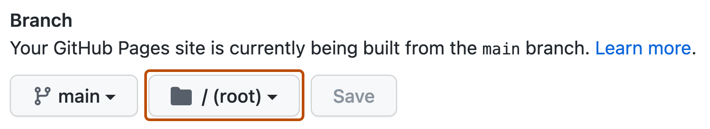

:::section{.lang-zh}

你把网页里的标题改成自己的名字，刷新，成功了。配色也调好了，按钮能点，越看越满意。

然后把地址发给朋友。

```text
file:///C:/Users/你的名字/Desktop/index.html
```

朋友当然打不开。浏览器刚才读的是你电脑里的文件，这个地址没有把文件送到互联网上。上篇[《一个网址如何找到服务器》](../02-how-a-url-finds-a-server/)里的 `127.0.0.1:8765` 也一样，换个人访问，找到的仍是他自己的电脑。

这次换我们当发布者。目标很简单：把页面放到 GitHub Pages，让朋友用一个普通网址打开它，再亲手完成一次更新。不用先装 Git，不用买域名，也不用急着给自己配一台云服务器。

## “静态网站”也可以有会动的按钮

GitHub Pages 可以把仓库里的 HTML、CSS、JavaScript 和图片发布成网站。HTML 放内容，CSS 管样式，浏览器执行 JavaScript，按钮照样能响应点击。[GitHub 对 Pages 的介绍](https://docs.github.com/en/pages/getting-started-with-github-pages/what-is-github-pages)说明了这种托管方式。

所以“静态”不等于“不能交互”。它说的是这套网站如何提供内容，不是屏幕上的东西必须一动不动。

不过，把 PHP 或 Python 文件上传进去，不会让 Pages 自动运行它们。真正的账户系统、跨设备保存的留言、需要密钥的 AI 请求，要有合适的后端服务。先别把这些全塞进第一张主页里，能独立发布和更新，已经够忙一阵了。

## 先让文件在自己电脑上正常工作

可以下载[示例网页与中文操作单](../../downloads/github-pages-starter.zip)，完整解压，打开 `student-site` 文件夹：

```text
student-site/
  index.html
  style.css
  script.js
  .nojekyll
  images/
    cover.jpg
```

双击 `index.html`，用浏览器打开。改名字和介绍，保存后刷新，再试试“打个招呼”按钮。它只是改变当前页面中的文字，不会发送留言；刷新后次数归零，是预期行为。

这份示例没有需要由服务端处理的功能，直接打开就能预览，不必启动上节课的 Python 实验服务。编辑时用纯文本编辑器，确认文件没有被保存成 `index.html.txt`。Mac 的文本编辑器也要留意是否处于纯文本模式。

不熟悉 HTML 的话，可以从这两处改起：

```html
<title>我的第一张主页</title>

<h1>你好，我是图灵社新同学</h1>
<p>这里记录我写过的代码，还有偶尔成功的尝试。</p>
```

`<title>` 对应浏览器标签页上的标题，`<h1>` 是正文里的大标题。只改一个，另一个不会自动跟着变。

准备公开发布时，记得把示例风景图换成自己拍摄或明确允许使用的图片，`alt` 描述也一起改。网页属于你，不代表里面随手找到的素材就都能自由转载。

## 不要把两个网址弄混

本次做一个名叫 `my-first-site` 的**项目站点**。把下面的 `你的用户名` 换成实际 GitHub 用户名：

```text
仓库：https://github.com/你的用户名/my-first-site
网站：https://你的用户名.github.io/my-first-site/
```

仓库里看代码、提交记录和设置；网站里看发布出来的页面。给朋友看作品，发后者。

GitHub 也支持用户主页站点：仓库名必须是 `用户名.github.io`，默认网址位于域名根目录。它和项目站点不是同一种命名方式，这篇先只走 `my-first-site` 这一条路，不去改已有的用户主页。

如果同名仓库已经存在，可以另取一个名字，但后面的路径也要跟着换。最终以 Pages 页面显示的地址为准，别背出一个网址却忘了自己的仓库叫什么。

## 给网页找个位置

用自己的账号登录 GitHub，在右上角 `+` 菜单选择 **New repository**。仓库名填 `my-first-site`，选 **Public**，开启 **Add README**，再创建仓库。


这里和下面的操作截图来自 [GitHub 官方文档](https://docs.github.com/en/repositories/creating-and-managing-repositories/creating-a-new-repository)，示例账号、仓库名与实际界面可能不同。照着找按钮即可，不必照抄图中的名称。

本篇按 GitHub Free 的公开仓库流程来做。操作自己的练习仓库就好，不要为了试设置去动社团正式网站。初始化 README 会让仓库先有一次提交和一个分支；分支通常叫 `main`，若你这里不同，记住实际名称。

进入仓库，选择 **Add file → Upload files**，上传 `student-site` **里面的内容**，不是外面那一层文件夹，更不是 ZIP 压缩包。根目录应该直接看到 `index.html`、`style.css`、`script.js` 和 `images`。


图中标出的是 **Add file** 按钮；展开后选择 **Upload files**。这张截图出自[官方文件上传说明](https://docs.github.com/en/repositories/working-with-files/managing-files/adding-a-file-to-a-repository)。

提交说明可以写：

```text
Add my first homepage
```

点 **Commit changes**。这会把改动记录为一次提交，之后可以回头看自己改过什么。它还不代表网页已经发布。

`.nojekyll` 是一个用于跳过 Jekyll 处理的空文件。如果文件管理器把它隐藏了、上传时没带上，可以在仓库里用 **Add file → Create new file** 添加这个名字的文件，再提交。这组纯 HTML/CSS/JS 不需要框架，也不需要自己编写 Actions 工作流。

## 开启 Pages，再等部署完成

打开**仓库的** Settings，不是个人账户设置。在侧栏找到 Pages，定位到 **Build and deployment**，选择：


图中的 **None** 表示还没有选择发布分支；在这里改成 `main`，目录选择根目录：

```text
Source：Deploy from a branch
Branch：main（或刚才实际上传的分支）
Folder：/ (root)
```

点 **Save**。下面是 GitHub 官方文档中的分支与目录选择界面，实际 UI 可能微调：



这些设置的意思是：取指定分支的根目录作为发布来源。选了 `/ (root)`，入口却在 `student-site/index.html`，网站自然可能找不到你以为放好的主页。[官方发布来源说明](https://docs.github.com/en/pages/getting-started-with-github-pages/configuring-a-publishing-source-for-your-github-pages-site)可以用来核对设置。

接下来到 **Actions** 看这一轮构建和部署。排队时给它一点时间，失败时打开失败步骤读日志，不必连续点 Save，更不用急着删仓库重来。

部署成功后，回 Pages 页面，通过 **Visit site** 打开网站。把这个网址发给朋友试试。仓库里有代码、部署任务成功、浏览器确实能打开页面，是三个不同阶段，最好各看一眼。

### 这个网址里，怎么没有 `:8765`？

```text
https://你的用户名.github.io/my-first-site/
```

现在用的是 HTTPS，省略端口时通常使用 `443`。`你的用户名.github.io` 是主机名，`/my-first-site/` 是路径，不是另一台电脑，也不是另一个端口。

DNS 和 HTTP 没有离场，只是服务由 GitHub Pages 托管，不需要你一直开着自己的本地实验程序。今天也不用配置自定义域名，先把发布这件事做完整。

## 上线后，别急着关开发者工具

上节课用过的 Network 面板，现在正好派上用场。打开开发者工具，切到 **Network**，再刷新网站，找这几个请求：

```text
文档页面
style.css
script.js
cover.jpg
```

看清请求 URL、路径和状态。成功响应常见 `200`，缓存验证可能返回 `304`；不是每次刷新都必须出现一排 `200` 才叫正常。

点开图片请求，看看路径里有没有 `/my-first-site/`。如果没有图片，浏览器比一句“GitHub 坏了”更容易提供线索。

### 本地有图片，上线却 404

假设页面地址是：

```text
https://你的用户名.github.io/my-first-site/index.html
```

这两种写法的去向不同：

| HTML 中的写法 | 浏览器请求的路径 |
| --- | --- |
| `./images/cover.jpg` | `/my-first-site/images/cover.jpg` |
| `/images/cover.jpg` | `/images/cover.jpg` |

开头多一个 `/`，就变成从域名根目录找，仓库名那一层不见了。对这里的项目站点，`./images/cover.jpg` 更合适。

再检查大小写：文件叫 `cover.jpg`，引用却写成 `Cover.jpg`，不能指望线上服务器帮你猜。`C:\Users\某人\Pictures\cover.jpg` 这种自己电脑上的路径就更不适合了，访问者并没有你的硬盘。

如果整个站点都 404，先查完整网址、发布分支和入口文件的位置；如果只有图片或样式 404，就聚焦那条资源请求。域名解析失败、连接失败则和 HTTP 404 分开判断：收到 404，至少说明已经有服务器回应了这次请求。

## 再改一次，才算知道怎么维护

第一次看到网站上线，很容易就想宣布完工。先等一下，再改一句介绍。

回仓库打开 `index.html`，点击编辑，保存为一次新提交，说明写 `Update my introduction`。到 Actions 看**最新那次**部署，完成后刷新 Pages 网站，请朋友确认看到的是新句子。

还没变？核对编辑的是不是发布分支、最新部署是否结束、打开的是不是正确网址，再考虑重新加载和缓存。别只看昨天那条绿色成功记录，它证明不了今天的修改已经上线。

你现在掌握的是一套很小、但完整的循环：改文件，提交，发布，验证。以后换成博客框架，环节会变多，这个区别仍然有用。

## 页面公开，秘密就别放进去

JavaScript 里的密钥、HTML 注释中的密码、用 Base64 编过的令牌，都不因为页面上没显示就变得安全。浏览器能收到的代码和资源，访问者就可能检查。

本次使用的仓库是公开的，Pages 页面也公开。即使某个方案允许用私有仓库发布，也不能顺手推导出“网站只有我能看”。[GitHub 的建站文档](https://docs.github.com/en/pages/getting-started-with-github-pages/creating-a-github-pages-site)也提醒发布前检查敏感数据。

如果真实凭证已经上传并泄露，先撤销或轮换，再处理仓库历史等残留。只删掉当前文件，收不回别人已下载的副本。

给第一张主页写一段自我介绍，放上有权使用的图片，再留一篇学习笔记，就已经有东西值得分享了。配色可以慢慢调，至少这次发给朋友的，不再是你桌面上的文件路径。

:::

:::section{.lang-en}

You change the heading to your name, refresh the page, and there it is. The colors look good. The button works. You send a friend the address:

```text
file:///C:/Users/your-name/Desktop/index.html
```

They cannot open it. Your browser was reading a file from your computer; that address did not put the file online. The `127.0.0.1:8765` address in [How a URL Finds a Server](../02-how-a-url-finds-a-server/) also points each visitor back to their own computer.

This time, we become the publisher. We will give the page a shareable GitHub Pages URL, then make an update. No Git installation, purchased domain, or self-managed cloud server is needed for this exercise.

## Static does not mean motionless

GitHub Pages publishes HTML, CSS, JavaScript, and images from a repository. The browser can still execute JavaScript and respond to clicks. “Static” describes how the content is served, not a ban on interaction. [GitHub's Pages introduction](https://docs.github.com/en/pages/getting-started-with-github-pages/what-is-github-pages) explains the hosting model.

Uploading PHP or Python files does not make Pages run a backend. Account systems, messages stored across devices, and AI requests requiring secret keys need an appropriate backend service. Those can wait until the homepage has somewhere to live.

## Check the files locally

Download the [starter files and Chinese worksheet](../../downloads/github-pages-starter.zip), extract everything, and open `student-site`:

```text
student-site/
  index.html
  style.css
  script.js
  .nojekyll
  images/
    cover.jpg
```

Open `index.html` in a browser. Edit the name and introduction, save, and refresh. The greeting button changes text in the current page; it does not send a message. Its counter resets on refresh because there is no server-side storage.

This example can be previewed directly, without starting the previous lesson's Python server. Use a plain-text editor, and check that the filename has not become `index.html.txt`. On macOS, make sure the editor is in plain-text mode.

These are easy places to start editing:

```html
<title>My first homepage</title>

<h1>Hello, I'm a new Turing Club member</h1>
<p>A place for my code and the attempts that occasionally work.</p>
```

`<title>` controls the browser tab's title; `<h1>` is the heading in the page. Changing one does not update the other.

Before publishing, replace the sample landscape with your own photograph or an image you have permission to use. Update its `alt` description too. Owning the webpage does not give you permission to republish every image you find.

## Two URLs, different jobs

We will use a **project site** with the repository name `my-first-site`. Replace `your-username` with your actual GitHub username:

```text
Repository: https://github.com/your-username/my-first-site
Website:    https://your-username.github.io/my-first-site/
```

The repository contains code, history, and settings. The website displays the published page. Send the second address when you want someone to visit your work.

A user site works differently: its repository must be named `username.github.io`, and its default URL is at the domain root. We will stick to the project-site route here rather than alter an existing user homepage.

If the repository name is already taken in your account, choose another and adjust the paths accordingly. Use the URL actually displayed in Pages settings.

## Put the page in a repository

Sign in to your own GitHub account, choose **New repository** from the top-right `+` menu, enter `my-first-site`, select **Public**, enable **Add README**, and create it.


These screenshots and the ones below come from [GitHub's official documentation](https://docs.github.com/en/repositories/creating-and-managing-repositories/creating-a-new-repository). Example accounts, repository names, and interface details may differ. Follow the controls, not the example names.

This walkthrough uses a public repository on GitHub Free. Keep the exercise separate from the club's production website. Initializing a README creates a commit and a branch. The branch is usually `main`; remember the actual name if yours differs.

Choose **Add file → Upload files**. Upload the **contents** of `student-site`, not the enclosing folder or the ZIP. The repository root should directly contain `index.html`, `style.css`, `script.js`, and `images`.


Open the highlighted **Add file** menu, then select **Upload files**. This screenshot is from the [official file-upload instructions](https://docs.github.com/en/repositories/working-with-files/managing-files/adding-a-file-to-a-repository).

Use a commit message such as:

```text
Add my first homepage
```

Click **Commit changes**. That records the change in the repository. It does not establish that the website has been published yet.

The empty `.nojekyll` file skips Jekyll processing. If hidden files were omitted during upload, add it with **Add file → Create new file** and commit it. This plain HTML/CSS/JS example needs neither a framework nor a custom Actions workflow.

## Enable Pages and wait for deployment

Open the **repository's** Settings, rather than your personal account settings. Find Pages in the sidebar, then **Build and deployment**:


**None** means no publishing branch has been selected. Change it to `main`, then select the root folder:

```text
Source: Deploy from a branch
Branch: main, or the branch you actually uploaded to
Folder: / (root)
```

Click **Save**. This branch-and-folder image comes from GitHub's official documentation; the interface may change slightly:


These settings publish from the chosen branch's root. If your entry file is nested at `student-site/index.html`, it is not where this configuration expects it. The [publishing source documentation](https://docs.github.com/en/pages/getting-started-with-github-pages/configuring-a-publishing-source-for-your-github-pages-site) provides a reference for the settings.

Open **Actions** to check this build and deployment. Allow time for a queued run. If it fails, inspect the failed step instead of repeatedly clicking Save or deleting the repository.

After success, return to Pages and use **Visit site**. Send that URL to a friend. Code in the repository, a successful deployment, and a working browser visit are different stages worth checking separately.

### Where did `:8765` go?

```text
https://your-username.github.io/my-first-site/
```

This URL uses HTTPS, whose default port is normally `443` when omitted. `your-username.github.io` is the hostname; `/my-first-site/` is a path, not a different computer or port.

DNS and HTTP still apply. GitHub Pages now hosts the service, so your local lab program does not have to stay running. Leave custom-domain configuration for another day.

## Keep developer tools open

Open developer tools, select **Network**, and refresh. Find the document and its resources:

```text
Document
style.css
script.js
cover.jpg
```

Check request URLs, paths, and statuses. Successful responses commonly use `200`; cache validation can return `304`. A healthy refresh does not require every row to show `200`.

Open the image request and look for `/my-first-site/` in its path. If the image is missing, that request gives you a more useful clue than “GitHub is broken.”

### Local images work, published images return 404

Suppose the page is at:

```text
https://your-username.github.io/my-first-site/index.html
```

These references resolve differently:

| Reference in HTML | Requested path |
| --- | --- |
| `./images/cover.jpg` | `/my-first-site/images/cover.jpg` |
| `/images/cover.jpg` | `/images/cover.jpg` |

The leading `/` starts at the domain root, dropping the repository prefix. For this project site, `./images/cover.jpg` is the appropriate reference.

Check case too: `cover.jpg` and `Cover.jpg` should not be mixed. A local path such as `C:\Users\someone\Pictures\cover.jpg` is unsuitable; visitors do not have your hard drive.

If the entire site returns 404, check the full URL, publishing branch, and entry-file location. If just an image or stylesheet fails, inspect that resource request. DNS or connection failure is different from receiving HTTP 404: a 404 means a server responded.

## Make an update before calling it finished

The first successful deployment is tempting to celebrate as the finish line. Change one more sentence first.

Open `index.html` in the repository, edit the introduction, and commit with a message such as `Update my introduction`. Watch the **latest** deployment in Actions. When it completes, refresh the Pages site and ask your friend to confirm the new text.

Still old? Check the edited branch, whether the newest deployment finished, and which website URL you opened before considering reloads and caching. Yesterday's green check cannot prove today's edit is live.

That gives you a small but complete publishing cycle: edit, commit, deploy, verify. A blogging framework may add steps later, but those distinctions remain useful.

## A public page is not a safe

Keys in JavaScript, passwords in HTML comments, and Base64-encoded tokens do not become confidential merely because the page does not display them. Visitors can inspect resources sent to their browser.

This repository and website are public. Even where a plan allows publishing from a private repository, do not assume the published site is private. [GitHub's site-creation documentation](https://docs.github.com/en/pages/getting-started-with-github-pages/creating-a-github-pages-site) warns about sensitive data before publication.

If an actual credential has leaked, revoke or rotate it before addressing repository history and other copies. Deleting the current file cannot retrieve what someone already downloaded.

A short introduction, an image you can legally use, and a learning note are enough for a page worth sharing. You can keep adjusting the colors. At least this time, the address you send a friend will not point to your desktop.

:::
